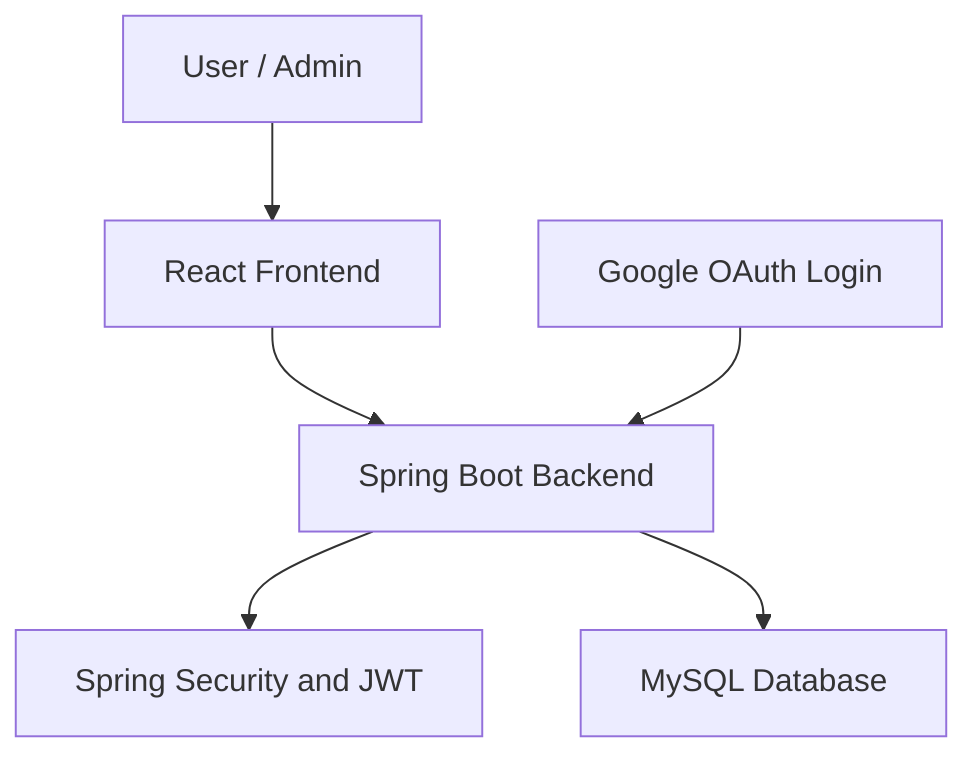

# EasyCart – Full Stack E-Commerce Application

EasyCart is a full-stack e-commerce web application built using **React, Spring Boot, and MySQL**. It includes user authentication, Google OAuth login, role-based authorization, product management, product image handling, product search, and shopping cart functionality.

## 🚀 Features

- User registration and login with JWT authentication
- Google OAuth 2.0 login
- Role-based access control for Admin and User roles
- Product creation, viewing, updating, and deletion
- Product image upload and retrieval
- Product search by keyword
- User-specific shopping cart operations
- MySQL database integration
- REST APIs built with Spring Boot

## 🛠️ Tech Stack

| Category | Technologies |
|---|---|
| Frontend | React, JavaScript, HTML, CSS, Vite |
| Backend | Java 21, Spring Boot |
| Database | MySQL |
| ORM | Spring Data JPA, Hibernate |
| Security | Spring Security, JWT, Google OAuth 2.0 |
| API | REST APIs, JSON |
| Build Tool | Maven |
| Version Control | Git, GitHub |

## 🏗️ Application Architecture



**Flow:** User → React Frontend → Spring Boot Backend → MySQL Database.

## 📂 Project Structure

```text
Ecommerce_project/
├── ecom-frontend-5/     # React frontend
│   ├── src/
│   ├── package.json
│   └── vite.config.js
└── ecom-backend/        # Spring Boot backend
    ├── src/
    │   └── main/
    │       ├── java/
    │       └── resources/
    │           └── application.properties
    └── pom.xml
```

*Folder names may vary slightly depending on the current repository version.*

## ⚙️ Getting Started

### Prerequisites

- Java Development Kit (JDK) 21
- Node.js and npm
- MySQL Server
- Git
- Maven, or the project's Maven Wrapper if available

### 1. Clone the Repository

```bash
git clone https://github.com/VDGayakwad/Ecommerce_project.git
cd Ecommerce_project
```

### 2. Configure the MySQL Database

Create a database in MySQL (use the same database name configured by your application):

```sql
CREATE DATABASE easycart;
```

Configure the database connection in the backend's `application.properties` file. The following is an example; adjust the database name and credentials to match your setup:

```properties
spring.datasource.url=jdbc:mysql://localhost:3306/easycart
spring.datasource.username=${DB_USERNAME}
spring.datasource.password=${DB_PASSWORD}
```

Keep passwords and other secrets out of GitHub.

### 3. Run the Spring Boot Backend

Open a terminal in the backend directory:

```bash
cd ecom-backend
mvn spring-boot:run
```

The backend is expected to run on port `8080` by default.

### 4. Run the React Frontend

Open a separate terminal:

```bash
cd ecom-frontend-5
npm install
npm run dev
```

Open the local URL shown by Vite, typically `http://localhost:5173`.

### 5. Configure Authentication

- Configure the JWT secret securely.
- Configure Google OAuth client credentials for Google login.
- Set the correct frontend redirect URL and OAuth callback configuration.
- Never commit passwords, client secrets, or JWT secrets to GitHub.

## 🔌 Backend API Endpoints

### Authentication APIs

| Method | Endpoint | Description |
|---|---|---|
| POST | `/api/auth/register` | Register a new user |
| POST | `/api/auth/login` | Log in and obtain a JWT |
| GET | `/oauth2/authorization/google` | Initiate Google OAuth login |

*Verify the registration and login paths against the authentication controller before publishing.*

### Product APIs

| Method | Endpoint | Description |
|---|---|---|
| GET | `/api/products` | Retrieve all products |
| POST | `/api/products` | Add a product with an image |
| PUT | `/api/products/{id}` | Update product details |
| DELETE | `/api/products/{id}` | Delete a product |
| GET | `/api/products/{id}/image` | Retrieve a product image |
| GET | `/api/products/search?keyword={keyword}` | Search products by keyword |

Product creation, updating, and deletion are intended for authorized administrators. Product browsing and image access depend on the Spring Security configuration.

### Shopping Cart APIs

| Method | Endpoint | Description |
|---|---|---|
| GET | `/api/cart` | Retrieve the logged-in user's cart |
| POST | `/api/cart/{productId}` | Add a product to the cart |
| DELETE | `/api/cart/{productId}` | Remove a product from the cart |
| DELETE | `/api/cart` | Clear the entire cart |

Cart endpoints require authentication and operate on the currently logged-in user's cart.

### Authentication Header

For JWT-protected requests, include the token in the request header:

```http
Authorization: Bearer <your-jwt-token>
```

### Example Local URLs

```text
http://localhost:8080/api/products
http://localhost:8080/api/products/search?keyword=phone
http://localhost:8080/api/cart
http://localhost:8080/api/cart/1
http://localhost:8080/api/auth/login
http://localhost:8080/api/auth/register
http://localhost:8080/oauth2/authorization/google
```

Replace `1` with a valid product ID when testing cart operations.

## 🔐 Security Implementation

- JWT-based authentication for protected requests
- Spring Security for access control
- Google OAuth 2.0 login integration
- Role-based authorization for admin-only product operations
- Password hashing using BCrypt
- Stateless security configuration for API authentication

## 🧠 Key Learning Outcomes

- Developing RESTful APIs using Spring Boot
- Integrating React with a Java backend
- Working with MySQL, JPA, and Hibernate
- Implementing JWT authentication and OAuth login
- Applying role-based access control
- Handling multipart requests and product image uploads
- Debugging API, database, and authentication issues
- Using Git and GitHub for version control

## 🔮 Future Enhancements

- Deploy the complete application to AWS
- Integrate an online payment gateway
- Add order management and order history
- Improve automated testing and application monitoring

## 👩‍💻 Developer

**Vaishnavi Gayakwad**  
B.E. Information Technology | 2026 Graduate

- GitHub: https://github.com/VDGayakwad
- LinkedIn: https://linkedin.com/in/vaishnavi-gayakwad-1867b5287/

---

*EasyCart is a learning project built to strengthen my full-stack development skills using Java, Spring Boot, React, and MySQL.*
